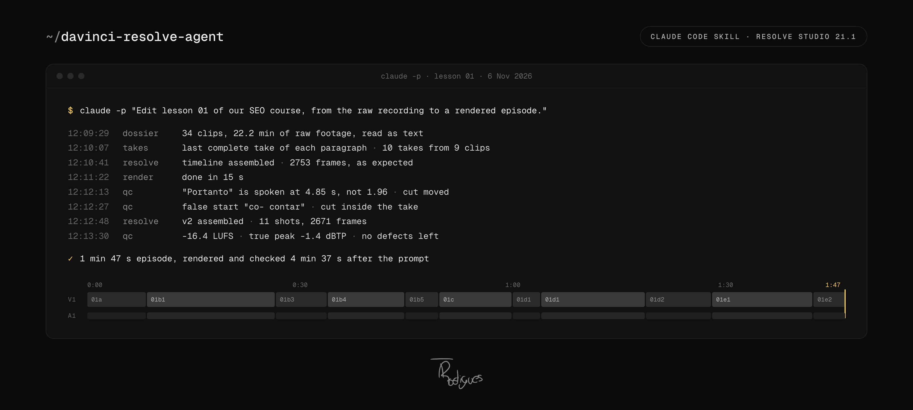

<p align="center">
  
</p>

# davinci-resolve-agent

> Claude Code edits, renders and checks your videos in DaVinci Resolve.

[](./LICENSE)
[]()
[]()
[]()
[](https://github.com/tiagonrodrigues/davinci-resolve-agent/actions/workflows/tests.yml)
[](https://skills.sh/tiagonrodrigues/davinci-resolve-agent)

An agent skill plus the scripts behind it. The agent reads word-level transcripts of the raw footage, keeps the last complete take of every paragraph, builds a frame-accurate cut list, assembles the timeline in DaVinci Resolve by script, renders it with a preset and checks the file before it says it's done: loudness, frames, bitrate, and a transcript of the final mix to catch words doubled or cut at the edits.

## The problem

We record the video lessons for [Forma](https://learnforma.com), a hands-on learning platform. A presenter reads a script to camera and retakes each paragraph until it comes out right, so the raw footage is mostly repeats. One recording session for the SEO course:

```
34 clips · 22.2 min of raw footage
~51 attempts at the 10 paragraphs of lesson 01, ~41 of them thrown away
11 shots · 1 min 47 s final episode
```

Picking takes by hand is slow, and the transcript already holds everything needed to do it. So on 6 November 2026 we gave lesson 01 to Claude Code, headless, with one prompt:

```
4 min 37 s   from the prompt to a rendered, checked episode
1 min 35 s   to the first timeline assembled in Resolve
15 s         render
2 defects    found by the agent's own QC and fixed before it answered
$1.64        of Claude, at API prices
```

The agent chose every take from the transcripts, built the timeline in Resolve, rendered it, transcribed its own render, found a word placed 3 s early after a clap and a false start the first cut had kept, fixed both, rendered again and checked again.

## How it works

The agent does not write a new assembly script every session. It calls saved scripts with parameters, reads what each one returns, and checks the result with numbers and frames.

| Step | Script | What happens |
|---|---|---|
| 1. Transcribe | `transcribe.py` | ElevenLabs Scribe, word-level timestamps, one JSON per clip |
| 2. Dossier | `dossier.py` | every clip as compact text: sentences with times, pauses, repeated attempts flagged |
| 3. Choose takes | the agent | the last complete take of each paragraph of the script |
| 4. Cut list | `cut_list.py` | in and out points on the quietest frame boundary, long pauses cut, alternating punch-in |
| 5. Assemble | `project.py`, `assemble.py` | project at the camera's frame rate, one import per call, timeline, Voice Isolation, markers |
| 6. Look | `frames.py` | frames straight from the timeline, no render |
| 7. Render | `render.py` | presets with "Force sizing to highest quality", mark in and out, wait until complete |
| 8. Verify | `qc.py`, `inspect_range.py` | LUFS and true peak, fps, frames, bitrate, frozen frames, transcript of the final mix |
| 9. Deliver | `loudness.py`, `deliver.py` | loudness to target, no timecode track, moov first, copy checked byte by byte |

Everything that runs inside Resolve goes through `run.py`, which talks to Resolve's own scripting API. An MCP server is optional: useful to look the API up and for one-off scripts.

## Install

### Requirements

- **DaVinci Resolve Studio 21.1 or later.** Since 21.1, Python scripting is Studio only. In Resolve: Preferences > System > General > External scripting using: **Local**.
- **Python 3.10+** with numpy and Pillow: `python3 -m pip install numpy pillow`.
- **ffmpeg and ffprobe.** `qc.py --simulate` also needs ffmpeg built with libvmaf.
- **An ElevenLabs API key** for transcription (Scribe): `export ELEVENLABS_API_KEY=...`, or a `.env` in the folder you work from (see [`.env.example`](./.env.example)).
- **Claude Code.**

Tested on macOS (Apple Silicon) with Resolve Studio 21.1.2. The scripts use the cross-platform scripting API and look for Resolve's default paths on Windows and Linux too, but only macOS has been run end to end.

### The skill

```bash
bunx skills add tiagonrodrigues/davinci-resolve-agent -g -a claude-code
```

This installs `davinci-resolve-agent` into `~/.claude/skills/`, scripts and render presets included. Check that Resolve answers:

```bash
python3 ~/.claude/skills/davinci-resolve-agent/scripts/resolve/run.py - '{}' <<< 'result = resolve.GetVersionString()'
```

### MCP servers (optional)

**Blackmagic's official server.** Resolve Studio 21.1 ships its own MCP server as an MCP bundle inside the app. It is proprietary (© Blackmagic Design), so this repo does not include it. On macOS, unpack it and register it with Claude Code:

```bash
mkdir -p ~/.local/share/resolve-mcp
unzip -o "/Applications/DaVinci Resolve/DaVinci Resolve.app/Contents/Resources/DaVinciResolve.mcpb" -d ~/.local/share/resolve-mcp
claude mcp add resolve -s user -- node ~/.local/share/resolve-mcp/server/index.js
```

Unpack it again after each Resolve update, so it matches the installed API. It gives `run_script`, `run_script_unsafe`, `search_scripting_api`, `get_scripting_api`, `get_scripting_docs` and `get_whats_new`, plus LUT and DCTL tools. Needs Node 18+.

**Community server.** [samuelgursky/davinci-resolve-mcp](https://github.com/samuelgursky/davinci-resolve-mcp) (MIT) covers the whole API with typed tools, and adds a few we use: a timeline frame returned as an image, replacing a clip or a source range, and checking a render's output. Its installer configures Claude Code:

```bash
npx davinci-resolve-mcp setup
```

**API reference.** Blackmagic's scripting README ships with Resolve (Help > Documentation > Developer, the `Scripting` folder), and the official MCP serves the current API stubs and docs through `search_scripting_api` and `get_scripting_docs`.

## Example request

The prompt we used for lesson 01, with the paths made generic:

```
Edit lesson 01 of our SEO course, from the raw recording to a rendered episode.

Raw camera clips: /path/to/raw-clips (word-level transcripts in /path/to/raw-clips/transcripts).
Script: /path/to/script.md, the "Lesson 01" section.

1. For each paragraph of the script, keep the last complete take. Cut hesitations, repeated
   attempts and long pauses. Decide from the transcripts.
2. Build the timeline in DaVinci Resolve, in a new project called "Lesson 01", with a 0.5 s
   pause between clips so we can watch it fill.
3. Render the episode to /path/to/out/lesson-01.mp4 (1920x1080, H.264), wait for the render to
   finish and check it with qc.py.

Use the davinci-resolve-agent skill. One ffmpeg at a time. Import one file per call into
Resolve. Don't open other apps.
```

Paste it into Claude Code, or run it headless the way the demo did:

```bash
claude -p "$(cat prompt.txt)" --output-format stream-json --verbose
```

Headless, the agent needs permission to run `python3` and `ffmpeg`. The demo ran with `--dangerously-skip-permissions`; only do that on a machine and folders you trust.

## Lessons learned

Real incidents from October and November 2026, each one now a rule in the skill.

- **96 ffmpeg processes froze the Mac.** An agent launched them in parallel, the screen locked up and the machine needed a reboot. Now it runs one ffmpeg at a time, at low priority, with 2 threads.
- **Resolve crashed on import.** Importing several ProRes files in one call took Resolve 21.1 down three times. Now it imports one file per call.
- **Our HDR tonemap was rejected twice.** The HDR to SDR conversion we wrote looked washed out. An SDR export from the camera owner fixed it; now we ask for it at the start.
- **The agent needs Resolve Studio.** In 21.1, Python scripting moved to Studio, and the official MCP server only ships with it.
- **A reel shipped at 6.8 Mbps.** ffmpeg's CRF saved bits on the dark background and the first upload looked soft. We deleted it and posted it again at 20 Mbps. Now the bitrate is checked with ffprobe before delivery.
- **We measured 25 fps on Instagram.** It serves a 25 fps Reel at 25, unconverted. The judder comes from ProMotion iPhones, which have no 25 or 50 Hz mode. Old footage stays at 25; new footage is shot at 29.97 with a 1/50 shutter, because the lights run at 50 Hz.
- **Instagram delivers far less than we upload.** A Reel with few views reaches people at 720x1280 and about 1.4 Mbps, with the sound normalised to about -14 LUFS. `qc.py --simulate` now simulates that delivery and scores it with VMAF before we post.
- **The "without graphics" render came out with graphics.** `SetTrackEnable` returns True and leaves the track on. Now the clips are disabled one by one and checked on an exported frame.
- **The render would not start.** On some timelines, `StartRendering` returns False when asked for the whole timeline. With in and out marked to the frame, it starts every time.
- **A cut joined the same word twice.** The opening of a lesson came out saying "decide, decide". Now Scribe transcribes the final mix and the agent looks for repeated words before calling the video done.
- **Skin retouching only exists in the UI.** The API cannot switch on Face Refinement, so the agent clicks it through macOS accessibility, without the mouse. With the screen locked the window vanishes from accessibility, while the API keeps working.
- **The agent stopped with the render running.** Headless, it ended its turn with "I'll let you know when it finishes", and nobody called it again. The prompt now says "wait for the render to finish".
- **The transcript put a word 3 s early.** A clap and a whisper came before "Portanto", and Scribe placed it at 1.96 s when it is spoken at 4.85 s. The agent's own QC caught it in the render, and it confirmed on the waveform before fixing the cut.
- **A false start survived the first cut.** "co- contar": the agent cut the "co-" inside the take, to the frame, and the punch-in hides the jump.
- **A helper wrote into the raw footage drive.** The range inspector used to save its image next to the clip, on the drive with the raw footage. Now it writes to the current folder.

What worked best:

- **The word-level transcript is the base of everything.** The agent picks takes, cuts on the silence between words and checks the result, all from the transcript.
- **Saved scripts instead of new code every time.** Fewer tokens, the same result every session.
- **Numbers and frames, never "looks good".** The agent quotes LUFS, frame counts and the transcript of its own render.
- **A living notes file.** What the person approved and rejected gets written down and read before the next video, so nobody asks for the same fix twice.
- **Taste stays human.** The agent assembles, measures and fixes. A person decides what stays.

## What's inside

```
skills/davinci-resolve-agent/
  SKILL.md                    the flow, delivery targets and every verified trap
  scripts/resolve/            run inside Resolve (through run.py)
    run.py  project.py  assemble.py  frames.py  render.py  swap_media.py
    presets/                  reel 1440x2560 H.264, master 3840x2160 ProRes 422 HQ
  scripts/media/              plain Python and ffmpeg
    transcribe.py  dossier.py  inspect_range.py  cut_list.py  add_markers.py
    qc.py  loudness.py  deliver.py
tests/                        the Resolve scripts against a fake Resolve API; cut list,
                              markers and dossier on synthetic transcripts
assets/src/                   sources of the hero image and the QR code
```

Every script answers `--help`. `python3 tests/test_resolve_scripts.py` and `python3 tests/test_media_scripts.py` check the scripts' own logic without Resolve or ffmpeg; the traps in the skill were measured on the real thing. The run in "The problem" used the Portuguese originals of these scripts; this repo has them translated and generalized.

## License

MIT. See [LICENSE](./LICENSE).

DaVinci Resolve is a trademark of Blackmagic Design. This project is not affiliated with or endorsed by Blackmagic Design.

## Credits

Built by [Tiago Rodrigues](https://www.tiagonrodrigues.com) to edit the lessons at [Forma](https://learnforma.com).
